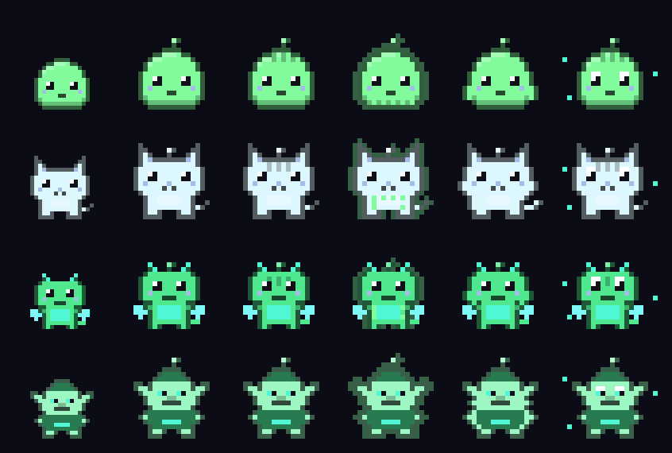
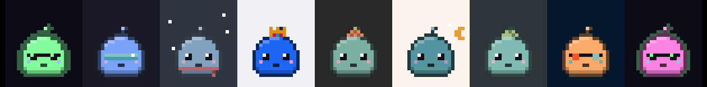

# Desktop Pet for Omarchy

**A tiny pixel pet that lives on your desktop, eats the letters in your terminal, grows up over weeks, and chats in character.**

[](https://buymeacoffee.com/3thand)

```sh
omarchy plugin add https://github.com/3thanD/desktop-pet.git --enable
```

 <!-- hero shot: record with tools/make-media.sh (docs/hero.png + GIFs), then point this at docs/hero.png -->

An egg appears on your desktop and hatches into a slime (or a cat, a baby dragon or a goblin).
It wanders around, gets hungry, hops over to your terminal and nibbles letters right off the
screen. It wears your Omarchy theme, sleeps at night, plays fetch, cheers when your tests pass
and slowly grows up: baby, teen, adult (shaped by what it eats) and, for the best-loved pets, elder.



## Features

| | |
|---|---|
| **Four pets** | slime, cat, baby dragon (breathes fire: text turns red), goblin (borrows your dock icons, always gives them back) |
| **Eats your terminal** | hops to btop or any kitty window and munches 2-5 letters; the letters really vanish (overlay patches that heal after a few minutes) |
| **Grows with you** | hatches from an egg and evolves over real days of care: baby → teen → adult (classic / cyber / chonk, from its diet) → elder |
| **Theme-aware** | recolors live with `omarchy theme set`, a little accessory per theme, a complementary-color mode and custom colors |
| **Fetch** | throw a ball, or grab and flick it with the mouse; the pet chases it and brings it back |
| **Build buddy** | optional shell hook: winces at failed commands, cheers passing tests, dances on `git push` |
| **A brain (optional)** | short in-character lines through your own Claude Code CLI, tools disabled, rate-limited, canned lines offline |
| **Right-click menu** | every setting, stats with age, "say something", feed, fetch, heal, turn off |
| **A friendly CLI** | `desktop-pet` with colored stat bars, previews and tab completion |
| **Light** | small surfaces, ~15 fps only while moving, nothing animates when idle; built on a CPU-only VM |

## Compatibility

- **v0.1 supports Omarchy (Hyprland) only.** It is an Omarchy shell plugin and uses Hyprland for
  window and monitor information.
- A standalone mode for plain Hyprland (no Omarchy) is planned for v0.2.0
  ([docs/STANDALONE.md](docs/STANDALONE.md)).
- GNOME is not supported (no layer-shell). Sway, niri and KDE can be added as adapters.
- Letter-eating needs kitty (Omarchy's btop runs in kitty). Multiple monitors and fractional
  scaling are supported; the pet lives on the focused monitor.

## Install

```sh
omarchy plugin add https://github.com/3thanD/desktop-pet.git --enable
```

An egg appears and hatches within a few seconds. Name your pet with a right-click → **name**.
That's all you need for a pet that walks, plays, evolves and follows your theme.

### Setup for letter-eating (and the rest)

```sh
~/.config/omarchy/plugins/3thand.desktop-pet/bin/desktop-pet setup
```

Setup explains every change before making it, backs up each file it edits, is safe to run again,
and only touches files in your home directory:

- links `~/.local/bin/desktop-pet` and its bash completion
- adds **SUPER+CTRL+P** (toggle the pet) to `~/.config/hypr/bindings.lua`. This replaces
  Omarchy's default SUPER+CTRL+P (Power panel); the power menu is still on SUPER+ESCAPE.
- enables kitty remote control in `~/.config/kitty/kitty.conf` **only if it isn't already on**
  (current Omarchy ships it, so usually nothing changes). It is `socket-only`, with the socket in
  your private runtime dir, so only your user can connect.
- asks whether to install the optional **build buddy** shell hook (or pass `--buddy`)

Reopen kitty windows (and btop) if remote control was just enabled. Until eating works, the pet
shows a one-time hint and snacks on berries instead.

If you cloned the repo by hand, `./install.sh` links the clone in as the plugin and runs setup.

## Playing with your pet

- **Left-click**: pet it (hearts). Tapping the egg makes it hatch sooner.
- **Right-click** (or SUPER+SHIFT+left-click): the menu, with stats and age at the top.
- **Fetch**: `desktop-pet fetch` or menu → *throw ball*. Grab the ball and flick it with the
  mouse; longer throws make it happier. The dragon may toast it, the goblin may run off with it.
- **Night**: it sleeps from 23:00 to 07:00 (click to wake it).
- It never dies. Neglected, it just gets sad or grumpy.

## Evolution

Growth needs real calendar time **and** care (a "care day" is a day you fed, petted or played with it):

| Stage | When |
|---|---|
| baby | hatches from the egg |
| teen | 2+ days old, 20+ meals, 2+ care days (about 2-3 days of normal use) |
| adult | 7+ days old, 70+ meals, 5+ care days (about a week). Its diet picks the form: mostly digits → **cyber** (circuit lines and glow), vowel-heavy → **chonk** (rounder), otherwise **classic** |
| elder | rare: 30+ days old, 300+ meals, 20+ care days, and happy at the time |

Each species keeps its own save, so switching from the slime to the cat and back keeps the
slime's progress. `desktop-pet evolve` shows the stages and your pet's progress;
`desktop-pet new` starts over with a new egg.

## Themes and colors

Colors come from the live theme, so `omarchy theme set ...` recolors the pet immediately.
Accessories per theme: shades and a green glow (Hackerman), a visor (Tokyo Night), a leaf hat
(Everforest), a scarf and snow (Nord), a crown (Catppuccin), moon and stars (Rose Pine), a pumpkin
(Gruvbox), a monochrome look (Matte Black, Vantablack, White), and more; custom themes get a bow.



`desktop-pet color complement` rotates the theme's colors to the opposite side of the color wheel
(kept at least 3:1 contrast with the background), and `desktop-pet color custom '#ff8800'` picks
your own. Eaten-letter patches always use the real theme background.

## Build buddy

With the optional shell hook (`desktop-pet setup --buddy`), the pet reacts to your terminal:
a failed command makes it wince, passing tests (`pytest`, `cargo test`, `npm test`, `go test`,
`make test`, ...) make it cheer, a successful `git push` gets a victory dance, and commands that
ran longer than 30 seconds get a "done!" hop. Reactions are rate-limited.

The hook records **only** the command name (plus `push`/`test` for git/cargo/npm/go/make/yarn/pnpm),
the exit code and the duration, in `$XDG_RUNTIME_DIR/desktop-pet/buddy.json`. Never arguments,
paths or output. Turn reactions off with `desktop-pet buddy off`; remove the hook with
`desktop-pet uninstall`.

## Commands

```
desktop-pet                    status: pet, age, stage, stats, accessory

on | off | toggle              show / remove the pet (off removes every overlay
                               instantly, restores the dock). Key: SUPER+CTRL+P
pick <slime|cat|dragon|goblin> choose your pet (shortcut: desktop-pet cat)
list                           all pets with a tiny preview
name <name>                    name the current pet
feed                           toss a berry treat
fetch [on|off]                 throw a ball; on/off allows play
heal                           restore all eaten / burned text and dock icons now
wake                           wake the pet up
size <50|100|200>              pet size in percent (crisp pixel steps)
color <theme|complement|custom #hex>
accessory <auto|none|NAME>     theme accessory; 'accessory list' shows names
eat <on|off>                   allow eating letters from your terminal
goblin-steal <on|off>          allow the goblin to move/hide dock icons
buddy <on|off>                 react to your terminal commands
evolve [--preview]             evolution stages and progress
new [-y]                       start over with a new egg
theme-pet <theme> <pet|off>    optional: a specific pet on one theme
poke <hungry|fire|heist>       make it eat / breathe fire / steal right now

say "<message>"                talk to your pet (reply here and in its bubble)
chat                           interactive chat (Ctrl-D to exit)
brain <on|off>                 off = canned lines only, zero Claude calls
brain context <on|off>         also share the focused window title (default off)
chatty <off|low|normal|high>   how often it talks on its own
persona "<text>" | reset       override the personality
forget                         clear its short memory

setup [-y] [--buddy]           CLI link, completion, keybinding, kitty, buddy hook
uninstall [--purge]            undo setup, turn off, restore the dock
config | reset [-y] | coffee | help
```

## Configuration

Preferences live in `~/.config/desktop-pet/config.json` (the CLI and the menu both edit it; the
pet picks up changes live). The pet's life (stage, age, meals, diet, stats, per species) lives in
`~/.local/state/desktop-pet/state.json`, written atomically with a rolling `state.json.bak`; a
corrupt file is kept aside and the backup is used. Nothing is stored in the plugin directory, so
`omarchy plugin update` never touches your pet.

```json
{
 "pet": "slime", "names": { "slime": "Pixel" }, "size": 100, "color": "theme",
 "accessory": "auto", "eat": true, "goblinSteal": true, "fetch": true, "buddy": true,
 "chatty": "low", "brain": true, "brainContext": false, "persona": {}, "themePets": {}
}
```

## The brain (Claude) and privacy

If the [Claude Code](https://claude.com/claude-code) CLI is installed (`claude` on your PATH,
or a mise/npm install in your home), the pet can say short in-character lines and answer
`desktop-pet say` / `chat`. Without it, or with `desktop-pet brain off`, it uses built-in canned
lines and makes **zero** Claude calls.

- Calls run `claude -p --model haiku` with **all tools disabled** (`--tools ""`), no MCP servers,
  no session persistence and no user settings or hooks. The reply is display text only: stripped
  to plain text, capped at ~120 characters, never executed.
- **Sent:** the pet's name, type, stage, age, stats and mood, the time of day, the theme name, and
  recent pet events (the few letters it ate, being petted, a command name and exit code from the
  build buddy).
- **Not sent:** window titles, clipboard, terminal contents beyond the eaten letters or command
  arguments, unless you opt in with `desktop-pet brain context on` (adds the focused window's
  class and title).
- Rate limits protect your usage: spontaneous lines about every 15-25 min on `low` (default),
  8 min on `normal`, 4 min on `high`; automatic calls are capped at 8 / 16 / 30 per hour.
  `say` and `chat` always go through because you asked.
- The only thing the plugin ever starts that touches the network is that optional local
  `claude` CLI. Nothing needs sudo.

## Turning it off and uninstalling

- **Off:** `desktop-pet off`, SUPER+CTRL+P, or menu → *turn off*. Every overlay disappears and any
  borrowed dock icon is put back. `desktop-pet on` brings it back.
- **Undo setup:** `desktop-pet uninstall` removes the CLI and completion links, the keybinding,
  the kitty lines and the shell hook it added (each with a backup) and restores the dock.
  `--purge` also deletes settings and your pet's save.
- **Remove the plugin:** `omarchy plugin remove 3thand.desktop-pet`.

## Performance

Built and tested on a GPU-less VM where everything renders on the CPU:

- one small pet window that moves by changing its layer-shell margins, about 15 fps only while
  walking; idle animation is a ~2 fps frame flip; nothing full-screen, no blur or shaders
- the terminal is read only when the pet is about to eat; window geometry is polled every 2 s only
  while patches are on screen; the fetch ball runs physics at 20 fps only while it flies
- measured on that VM: the shell process uses about 1% CPU with the pet idle and about 5% while it
  walks (the compositor pays extra while anything moves on a CPU renderer)

## Porting to other distros (help wanted!)

The pet is deliberately split into small layers (see [docs/ARCHITECTURE.md](docs/ARCHITECTURE.md)):
a host adapter (`OmarchyHost.qml`), compositor adapters (`scripts/adapters/`) and terminal
adapters (`scripts/terminals/`). Everything else is plain Quickshell and Python.

Ports are very welcome:

1. **Ubuntu / Debian / Fedora with Hyprland**: the standalone entry point in
   [docs/STANDALONE.md](docs/STANDALONE.md) is most of the work.
2. **Sway, niri, KDE Plasma**: write a compositor adapter from `scripts/adapters/template.py`.
3. **More terminals** (WezTerm, Ghostty, foot, Alacritty): a terminal adapter that can read the
   screen.

See [CONTRIBUTING.md](CONTRIBUTING.md) and open an issue to say what you're porting.

## Troubleshooting

- **It never eats letters:** run `desktop-pet setup`, then reopen kitty. `ls $XDG_RUNTIME_DIR | grep kitty`
  should show a socket for your kitty process. Splits inside one kitty window are skipped.
- **Patches slightly off:** they assume kitty's default `placement_strategy center`. Please open an
  issue with your font size, padding and monitor scale.
- **`desktop-pet: command not found`:** run setup and make sure `~/.local/bin` is on your PATH.
- **Changed the QML and nothing happened:** the Omarchy shell keeps a cached copy of plugin code;
  run `omarchy restart shell` after editing it.
- **Logs:** `quickshell log -p /usr/share/omarchy/shell | grep -i pet` and `omarchy-shell shell listPlugins`.
- **The goblin doesn't move icons:** that needs `nwg-dock-hyprland` with pinned apps; without it the
  goblin only pretends. A journal is written before the dock is touched, so `off`, `heal`, a reload
  or a crash always puts the icons back.

## Support

If your pet makes you smile, you can [buy me a coffee](https://buymeacoffee.com/3thand) (or run `desktop-pet coffee`).

## License

MIT, see [LICENSE](LICENSE). Original characters; not affiliated with any virtual-pet brand.
